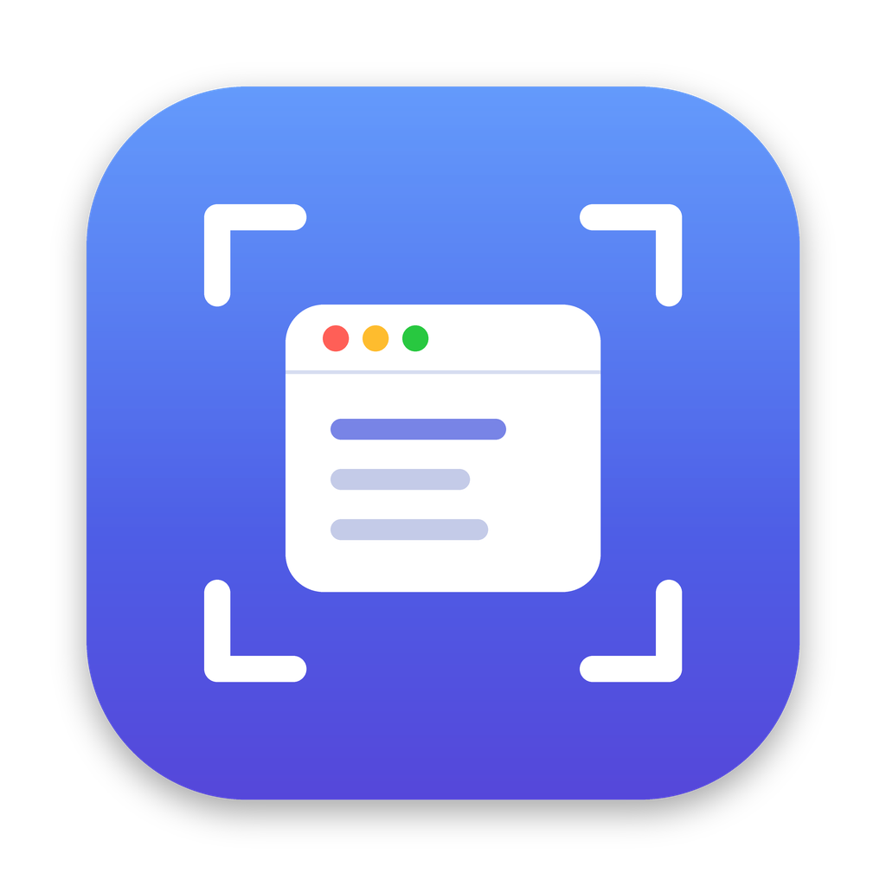
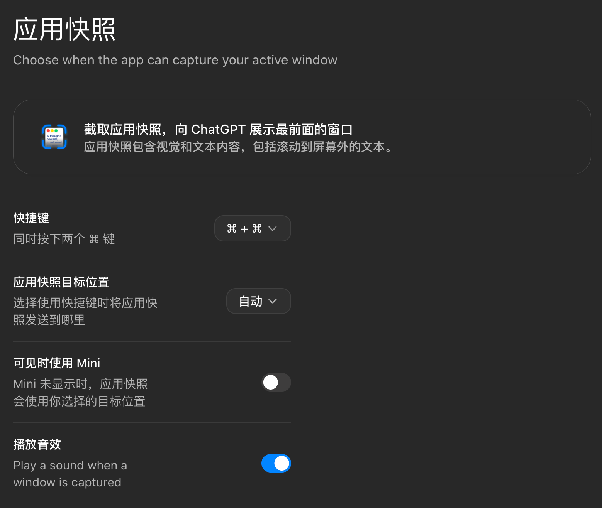
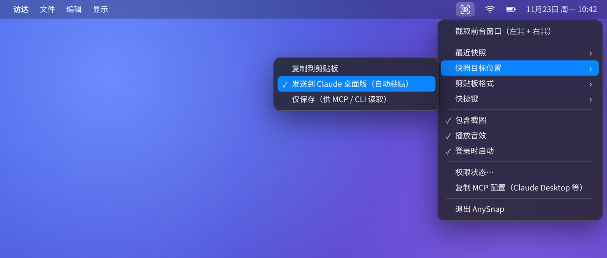
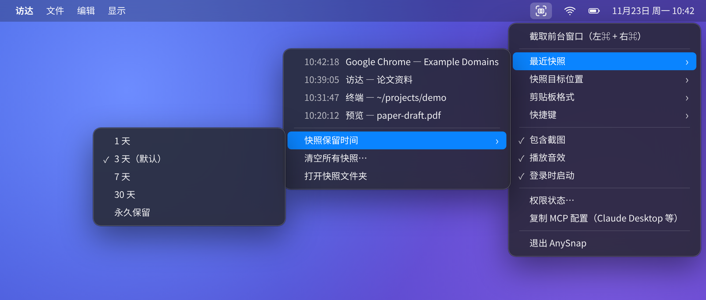

<p align="center"></p>

# AnySnap

<p align="center"><b>English</b> · <a href="README.zh-CN.md">简体中文</a></p>

**A Codex-style "app snapshot" for any AI agent on macOS.** Press left ⌘ + right ⌘ to capture the frontmost window: AnySnap saves a screenshot *plus* the window's full text from the accessibility tree — including content scrolled off-screen — and useful context the picture can't show (file paths, a terminal's working directory, the other browser tabs …). Agents read it through an MCP server or a CLI, so it works with Claude Desktop, Claude Code (with any model backend, e.g. DeepSeek), Codex and others.

## Same feature as Codex "App Snapshot"

AnySnap reproduces the **App Snapshot** feature of the Codex app and makes it available to other AI agents:

<p align="center"></p>
<p align="center"><sub>The App Snapshot settings in the Codex app (screenshot, for comparison)</sub></p>

| | Codex App Snapshot | AnySnap |
|---|---|---|
| Hotkey to capture the frontmost window | ⌘ + ⌘ | Left ⌘ + right ⌘ (configurable) |
| Screenshot + window text, including text scrolled off-screen | ✅ | ✅ |
| Choose where snapshots are sent | ✅ | ✅ Claude Desktop / clipboard / save only |
| Shutter sound | ✅ | ✅ |
| "Mini" window | ✅ | — |
| Works with | Codex / ChatGPT | Claude Desktop, Claude Code (any backend, e.g. DeepSeek), Codex, and any agent that supports MCP or a CLI |

> AnySnap is an independent project and is not affiliated with or endorsed by OpenAI. Codex and ChatGPT are trademarks of OpenAI.

## Features

- Press **left ⌘ + right ⌘** (configurable) to capture the frontmost window, with an optional shutter sound
- Besides the screenshot, reads the window's **full text, including content scrolled off-screen**; falls back to OCR when Accessibility permission is not available
- Records context a screenshot can't show:

| Where | Extra context |
|---|---|
| Finder | Folder path, full paths of the selected files + size / modified date / type |
| Apps with an open file (Preview, Word, TextEdit …) | Full path of the file |
| Browsers (Chrome / Edge / Brave / Arc / Safari) | URL, plus titles and URLs of the other tabs in the window |
| Terminal / iTerm2 | Working directory and the running program |
| PDF readers | Current page |
| Excel / PowerPoint | Active sheet / current slide |
| Code editors | Cursor line |

- Where snapshots go: send to Claude Desktop (only the screenshot appears in the chat box; the AI fetches the full text through MCP automatically) / copy to clipboard / save only

## Screenshots

<p align="center"></p>
<p align="center"><sub>Menu bar menu — choose where snapshots go</sub></p>

<p align="center"></p>
<p align="center"><sub>Recent snapshots, retention period (3 days by default) and "delete all"</sub></p>

## How it works

```
┌────────────── AnySnap.app (menu bar) ──────────────┐
│ hotkey → capture frontmost window → save → deliver │
└────────────────────────────────────────────────────┘
          │ ~/Library/Application Support/AnySnap/snapshots/<id>/
          │   screenshot.png / context.md / meta.json
          ▼
   anysnap (CLI, also an MCP server)
   ├─ Claude Desktop ── MCP
   ├─ Claude Code (Anthropic / DeepSeek / … backends) ── MCP or `anysnap latest --context`
   └─ Codex / other harnesses ── MCP or the CLI
```

## Install

### Download (easiest)

Requires macOS 14+ (Apple silicon or Intel).

1. Download `AnySnap-<version>-macOS.zip` from the [latest release](https://github.com/qzuser123-eng/AnySnap/releases/latest) and unzip it.
2. Move **AnySnap.app** into the `Applications` folder **inside your home folder** (`~/Applications`; create it if needed), so the paths below work as written.
3. Open it. The app is not notarized by Apple, so macOS blocks the first launch: go to **System Settings → Privacy & Security**, scroll down and click **Open Anyway** (or run `xattr -dr com.apple.quarantine ~/Applications/AnySnap.app` once).

Every release is signed with the same (self-signed) "AnySnap Release" certificate, so macOS keeps the permissions below when you update.

### Build from source

Requires macOS 14+ and Xcode or the Command Line Tools (`xcode-select --install`).

```bash
git clone https://github.com/qzuser123-eng/AnySnap.git && cd AnySnap
chmod +x scripts/*.sh
./scripts/make-dev-cert.sh   # optional, once: sign with a stable certificate so rebuilds keep permissions
./scripts/install.sh         # build, install to ~/Applications and launch
```

After the first launch, allow AnySnap in **System Settings → Privacy & Security**:
- **Accessibility**: global hotkey and reading window text
- **Screen Recording**: window screenshots

Then quit and reopen AnySnap from the menu bar. When it first reads Finder, Terminal, a browser or Office, macOS asks once whether AnySnap may control that app. The menu bar item **Permission status…** shows what is granted.

## Connect your agents

**Claude Desktop**: edit `~/Library/Application Support/Claude/claude_desktop_config.json`, then quit (⌘Q) and reopen Claude. Or run `ANYSNAP_ADD_CLAUDE_MCP=1 ./scripts/install.sh` to add it automatically (a backup is made first):

```json
{
  "mcpServers": {
    "anysnap": {
      "command": "/Users/<you>/Applications/AnySnap.app/Contents/Helpers/anysnap",
      "args": ["mcp"]
    }
  }
}
```

**Claude Code** (Anthropic, DeepSeek or other backends):

```bash
claude mcp add -s user anysnap -- ~/Applications/AnySnap.app/Contents/Helpers/anysnap mcp
```

**Codex CLI**: `codex mcp add anysnap -- ~/Applications/AnySnap.app/Contents/Helpers/anysnap mcp`

**Harnesses without MCP**: add to their system prompt or AGENTS.md:
> When the user says "look at this window" or "what I just captured", run `anysnap latest --context` to read the snapshot; read the screenshot path in its output if you need the image.

### MCP tools

| Tool | What it does |
|---|---|
| `get_latest_snapshot` | Latest snapshot (the AI calls it automatically when you send a screenshot, to get the full text) |
| `capture_window` | Capture the frontmost window now (the AI client's own window is skipped); `app` targets a specific app |
| `list_snapshots` / `get_snapshot` | Browse earlier snapshots |

Text-only models (e.g. DeepSeek) should pass `include_screenshot: false`. Captures requested through MCP / CLI are performed by the running AnySnap.app, so they use AnySnap's own permissions.

## CLI

```bash
anysnap capture            # from a terminal, skips the terminal itself and captures the window behind it
anysnap capture --app Safari --context
anysnap latest --json
anysnap list
anysnap doctor             # check permissions
```

## Menu bar options

| Option | Description |
|---|---|
| Hotkey | Left + right ⌘ (default), left + right ⌥, double-tap ⌘, or record any shortcut |
| Snapshot destination | Send to Claude Desktop / copy to clipboard / save only |
| Clipboard format | Auto: screenshot only for Claude, a path reference for terminals, screenshot + context.md for other apps |
| Recent snapshots | Copy an earlier snapshot again, retention period, delete all snapshots |
| Include screenshot / Play sound / Launch at login | Toggles |

## Privacy

- Snapshots (screenshots and window text) stay on your Mac and are **deleted after 3 days by default** (1 / 7 / 30 days or forever are available); at most 100 are kept, and you can delete all of them at once
- Password managers (1Password, Bitwarden, KeePassXC, Keychain Access, Passwords …) are **never captured**
- **Note**: once connected through MCP, an AI can call `capture_window` to capture your current window without you pressing the hotkey. If you don't want that, only add AnySnap to an agent's MCP config when you need it
- No network access, no uploads: snapshots leave your Mac only through the agents you configure

## Development

```bash
AUTO_INSTALL=1 ./scripts/watch-build.sh   # rebuild, reinstall and relaunch on every source change
python3 scripts/make-icon.py              # regenerate the app icon
```

See [AGENTS.md](AGENTS.md) for the code layout.

## Known limitations

- Text quality depends on each app's accessibility support. Native apps, Safari, Chrome and Electron apps work well; apps that draw their own UI (some games, Java apps) may expose no text, in which case AnySnap falls back to OCR.
- From macOS 27.3, ordinary apps can't simply be added to the Accessibility list; full-text capture needs that permission, otherwise only OCR of the visible area is available.
- "Send to Claude Desktop" activates Claude and simulates ⌘V, so Claude's input box needs to have focus.

## Feedback

Feedback is very welcome! Report a bug or suggest a feature in [Issues](https://github.com/qzuser123-eng/AnySnap/issues/new/choose), or ask questions and share ideas in [Discussions](https://github.com/qzuser123-eng/AnySnap/discussions).

## License

[MIT](LICENSE) © 2026 qzuser
