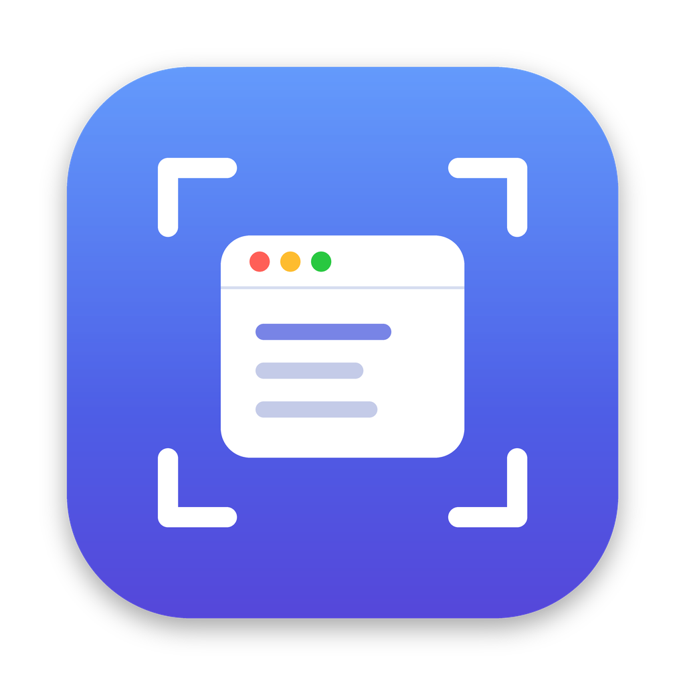
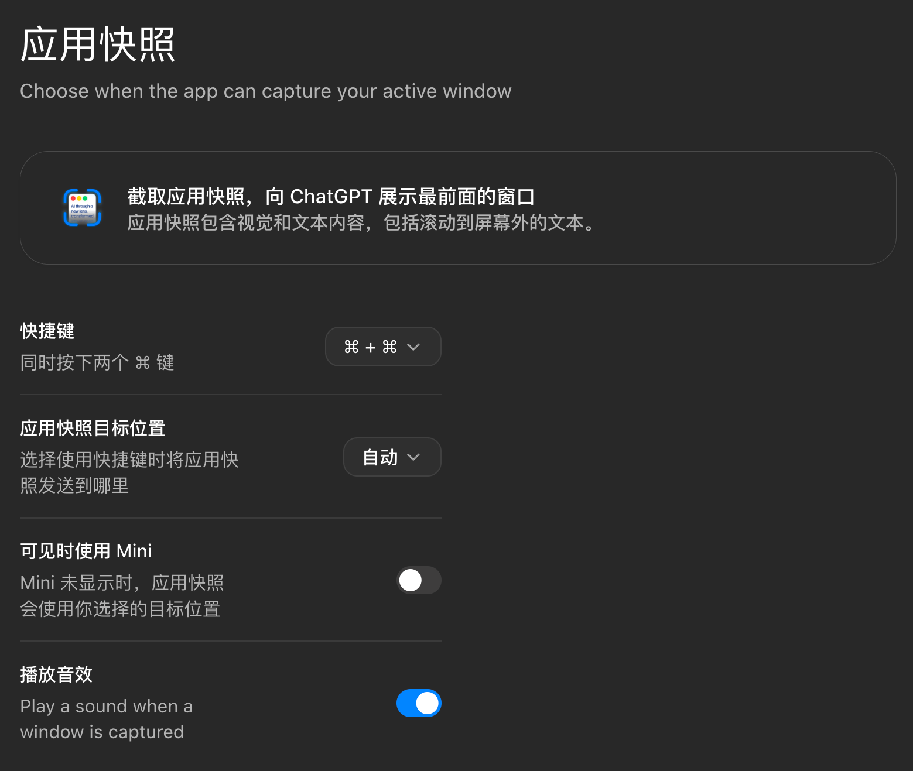
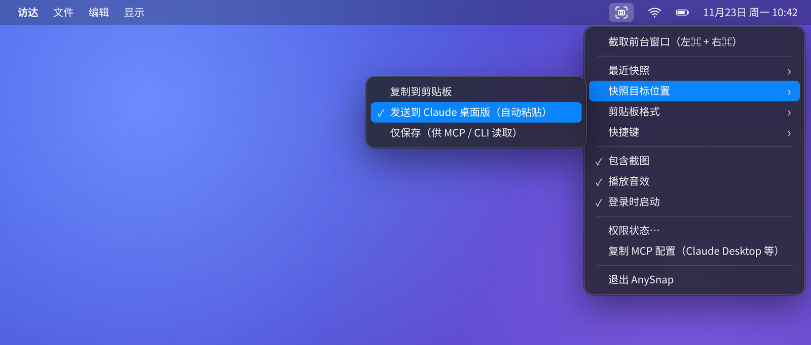
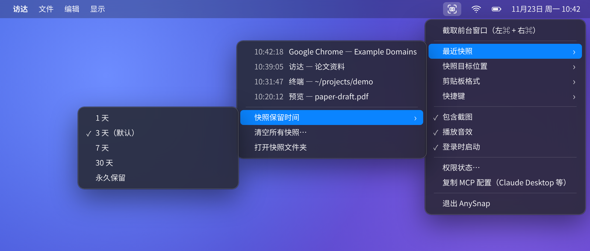

<p align="center"></p>

# AnySnap

<p align="center"><a href="README.md">English</a> · <b>简体中文</b></p>

给 Claude Desktop、Claude Code（包括接 DeepSeek 等后端）、Codex 等 agent 用的「应用快照」工具，功能对标 Codex 的 App Snapshot。

## 和 Codex「应用快照」一样的功能

AnySnap 复刻了 Codex 桌面版的**应用快照**功能，并让其他 AI agent 也能用上：

<p align="center"></p>
<p align="center"><sub>Codex 桌面版中的「应用快照」设置（截图，用于对比）</sub></p>

| | Codex 应用快照 | AnySnap |
|---|---|---|
| 快捷键截取最前面的窗口 | ⌘ + ⌘ | 左⌘ + 右⌘（可改） |
| 截图 + 窗口文字，包括滚动到屏幕外的文本 | ✅ | ✅ |
| 选择快照发送到哪里 | ✅ | ✅ Claude 桌面版 / 剪贴板 / 仅保存 |
| 截取时播放音效 | ✅ | ✅ |
| Mini 小窗 | ✅ | — |
| 可用的 AI | Codex / ChatGPT | Claude Desktop、Claude Code（含 DeepSeek 等后端）、Codex，以及任何支持 MCP 或命令行的 agent |

> AnySnap 是独立项目，与 OpenAI 无关，也未获其认可。Codex 和 ChatGPT 是 OpenAI 的商标。

## 功能

- 按 **左⌘ + 右⌘**（可改）截取最前面的窗口，截图时可播放音效
- 截图之外，读取窗口的**全部文字，包括滚动到屏幕外的内容**；没有无障碍权限时自动退回 OCR
- 截图看不到、但对 AI 有用的信息也一并记录：

| 场景 | 额外记录的内容 |
|---|---|
| 访达 | 当前文件夹路径、选中文件的完整路径 + 大小 / 修改时间 / 类型 |
| 打开文件的应用（预览、Word、文本编辑…） | 文件的完整路径 |
| 浏览器（Chrome / Edge / Brave / Arc / Safari） | 网址，以及同一窗口里其他标签页的标题和网址 |
| 终端（Terminal / iTerm2） | 当前工作目录、正在运行的程序 |
| PDF 阅读器 | 当前页码 |
| Excel / PowerPoint | 当前工作表 / 当前第几张幻灯片 |
| 代码编辑器 | 光标所在行 |

- 快照目标位置：发送到 Claude 桌面版（输入框里只出现截图，完整文字由 AI 通过 MCP 自动读取）/ 复制到剪贴板 / 仅保存

## 界面

<p align="center"></p>
<p align="center"><sub>菜单栏菜单：选择快照发送到哪里</sub></p>

<p align="center"></p>
<p align="center"><sub>最近快照、快照保留时间（默认 3 天）和一键清空</sub></p>

## 工作方式

```
┌────────────── AnySnap.app（菜单栏）──────────────┐
│ 全局快捷键 → 截取前台窗口 → 保存快照 → 按目标位置分发 │
└──────────────────────────────────────────────────┘
          │ ~/Library/Application Support/AnySnap/snapshots/<id>/
          │   screenshot.png / context.md / meta.json
          ▼
   anysnap（CLI，同时也是 MCP 服务器）
   ├─ Claude Desktop ── MCP
   ├─ Claude Code（Anthropic / DeepSeek 等后端）── MCP 或 `anysnap latest --context`
   └─ Codex / 其他 harness ── MCP 或直接调用 CLI
```

## 安装

### 直接下载（最简单）

需要 macOS 14 以上（Apple 芯片和 Intel 都支持）。

1. 从 [最新版本](https://github.com/qzuser123-eng/AnySnap/releases/latest) 下载 `AnySnap-<版本>-macOS.zip` 并解压。
2. 把 **AnySnap.app** 放进**你个人目录下的**「应用程序」文件夹（`~/Applications`，没有就新建一个），这样下文的路径可以直接用。
3. 打开它。这个 app 没有经过苹果公证，第一次打开会被 macOS 拦下：到 **系统设置 → 隐私与安全性**，往下翻，点「**仍要打开**」（或者在终端运行一次 `xattr -dr com.apple.quarantine ~/Applications/AnySnap.app`）。

下载版是临时签名（ad-hoc），所以装新版本后 macOS 可能会让你重新授权下面的权限。

### 从源码编译

需要 macOS 14 以上，以及 Xcode 或 Command Line Tools（`xcode-select --install`）。

```bash
git clone https://github.com/qzuser123-eng/AnySnap.git && cd AnySnap
chmod +x scripts/*.sh
./scripts/make-dev-cert.sh   # 可选，只需一次：用固定证书签名，重新编译后不用重新授权
./scripts/install.sh         # 编译、安装到 ~/Applications 并启动
```

第一次启动后，到 **系统设置 → 隐私与安全性** 给 AnySnap 打开：
- **辅助功能**（macOS 27 起叫「**无障碍**」）：全局快捷键、读取窗口文字
- **屏幕录制**：窗口截图

授权后从菜单栏退出 AnySnap 再打开。读取访达、终端、浏览器、Office 信息时，macOS 会分别询问一次"是否允许 AnySnap 控制 XX"。菜单栏的「权限状态…」可以查看授权情况。

## 接入 agent

**Claude Desktop**：编辑 `~/Library/Application Support/Claude/claude_desktop_config.json`，然后 ⌘Q 重启 Claude。也可以运行 `ANYSNAP_ADD_CLAUDE_MCP=1 ./scripts/install.sh` 自动添加（修改前会备份）：

```json
{
  "mcpServers": {
    "anysnap": {
      "command": "/Users/<你的用户名>/Applications/AnySnap.app/Contents/Helpers/anysnap",
      "args": ["mcp"]
    }
  }
}
```

**Claude Code**（Anthropic 或 DeepSeek 等后端都适用）：

```bash
claude mcp add -s user anysnap -- ~/Applications/AnySnap.app/Contents/Helpers/anysnap mcp
```

**Codex CLI**：`codex mcp add anysnap -- ~/Applications/AnySnap.app/Contents/Helpers/anysnap mcp`

**不支持 MCP 的 harness**：在它的系统提示或 AGENTS.md 里加一句：
> 当用户说"看这个窗口 / 我刚截的图"时，运行 `anysnap latest --context` 读取快照；需要看图时读取输出里的 screenshot 路径。

### MCP 工具

| 工具 | 作用 |
|---|---|
| `get_latest_snapshot` | 读取最近一次快照（用户发来截图时，AI 会自动调用它拿完整文字） |
| `capture_window` | 立即截取前台窗口（自动跳过 AI 客户端自己的窗口），可用 `app` 参数指定应用 |
| `list_snapshots` / `get_snapshot` | 浏览历史快照 |

不支持看图的模型（如 DeepSeek）调用时传 `include_screenshot: false`，只用文字部分。MCP / CLI 截图会交给正在运行的 AnySnap.app 代劳，所以用的是 AnySnap 自己的权限。

## CLI

```bash
anysnap capture            # 从终端运行时会跳过终端本身，截取它后面的窗口
anysnap capture --app Safari --context
anysnap latest --json
anysnap list
anysnap doctor             # 检查权限
```

## 菜单栏选项

| 选项 | 说明 |
|---|---|
| 快捷键 | 同时按左右 ⌘（默认）、同时按左右 ⌥、双击 ⌘，或录制任意组合键 |
| 快照目标位置 | 发送到 Claude 桌面版 / 复制到剪贴板 / 仅保存 |
| 剪贴板格式 | 自动：发给 Claude 时只贴截图，终端里贴路径引用，其他应用贴截图和 context.md |
| 最近快照 | 重新复制某次快照、快照保留时间、清空所有快照 |
| 包含截图 / 播放音效 / 登录时启动 | 开关 |

## 隐私

- 快照（截图和窗口文字）只保存在本机，**默认 3 天后自动删除**（可改为 1 / 7 / 30 天或永久），最多保留 100 个，也可一键清空
- 1Password、Bitwarden、KeePassXC、钥匙串访问、「密码」App 等密码管理器**不会被截取**
- **注意**：接入 MCP 后，AI 可以通过 `capture_window` 主动截取你当前的窗口，不需要你按快捷键。如果不希望这样，只在需要时才把 AnySnap 加进 agent 的 MCP 配置
- 不联网、不上传，快照只会通过你配置的 agent 发出去

## 开发

```bash
AUTO_INSTALL=1 ./scripts/watch-build.sh   # 源码一变就自动编译、安装并重启 AnySnap
python3 scripts/make-icon.py              # 重新生成图标
```

代码结构见 [AGENTS.md](AGENTS.md)。

## 已知限制

- 文字读取效果取决于应用对无障碍接口的支持。原生应用、Safari、Chrome、Electron 应用都不错；少数自绘界面的应用（部分游戏、Java 程序）可能读不到文字，这时退回 OCR。
- macOS 27.3 起普通应用无法直接加入「无障碍」列表，读取全文需要先完成授权；否则只有 OCR（仅屏幕上可见的文字）。
- 「发送到 Claude」是先激活 Claude 窗口再模拟 ⌘V，要求 Claude 的输入框处于焦点。

## 反馈

非常欢迎提意见！遇到问题或想要新功能，请到 [Issues](https://github.com/qzuser123-eng/AnySnap/issues/new/choose) 提交；想交流用法、聊想法，欢迎来 [讨论区](https://github.com/qzuser123-eng/AnySnap/discussions)。

## License

[MIT](LICENSE) © 2026 qzuser
